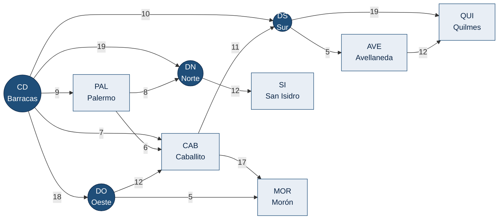

<div align="center">

# Red Logística de Depósitos y Centros de Distribución

### Trabajo Práctico Obligatorio — Programación III

Sistema en **Spring Boot** y **Neo4j** que modela la red logística de una empresa de
distribución del Área Metropolitana de Buenos Aires e implementa sobre ella los algoritmos
de grafos, ordenamiento, selección y optimización de la materia.


</div>

---

| | |
|---|---|
| **Universidad** | Universidad Argentina de la Empresa (UADE) |
| **Asignatura** | Programación III (3.4.077) |
| **Período** | 2° cuatrimestre 2026 — Comisión Miércoles Mañana |
| **Docente** | Manuel Adrián Cáceres |
| **Entrega final** | 28/10/2026 — tag `entrega-final` |
| **Repositorio base** | [Scaffold de la materia](https://github.com/Mancaceresuade/tpo-scaffold-2026) |

## Integrantes

| Nombre completo | Usuario de GitHub | Responsabilidad |
|---|---|---|
| Tiziano Greco | [@TizianoGreco](https://github.com/TizianoGreco) | Grafos y configuración |
| Nicolas Cortese | [@nicortese](https://github.com/nicortese) | _(completar)_ |
| _(completar)_ | _(completar)_ | _(completar)_ |

## Contenido

1. [Resumen](#1-resumen)
2. [Dominio](#2-dominio)
3. [Modelo de datos](#3-modelo-de-datos)
4. [Algoritmos implementados](#4-algoritmos-implementados)
5. [Resultados verificados](#5-resultados-verificados)
6. [Arquitectura](#6-arquitectura)
7. [Instalación y ejecución](#7-instalación-y-ejecución)
8. [Pruebas](#8-pruebas)
9. [Documentación complementaria](#9-documentación-complementaria)
10. [Organización del trabajo](#10-organización-del-trabajo)
11. [Uso de inteligencia artificial](#11-uso-de-inteligencia-artificial)

---

## 1. Resumen

Una empresa de logística mueve paquetes entre sus **centros de distribución** y sus
**depósitos** del AMBA. Los camiones circulan por rutas con sentido de circulación, y la
operación diaria plantea tres tipos de decisiones que el sistema resuelve con algoritmos
propios, sin librerías:

| Decisión | Algoritmos |
|---|---|
| **Qué recorrer:** cómo explorar la red, cuál es el camino más corto entre dos nodos, qué red mínima de rutas conecta a todos | BFS, DFS, Dijkstra, UCS, Floyd-Warshall, Prim, Kruskal, Backtracking |
| **Qué cargar:** qué paquetes subir a un vehículo de capacidad limitada maximizando el valor | Greedy, Mochila 0/1 (programación dinámica), QuickSort, MergeSort |
| **Cómo repartir:** cómo distribuir todos los paquetes entre k vehículos minimizando la carga del más cargado | Branch & Bound |

Cada algoritmo se expone como un endpoint REST, opera sobre el grafo cargado en memoria y
está acompañado de tests unitarios y de su ficha con complejidad justificada.

## 2. Dominio

| Concepto | En el dominio | En el modelo |
|---|---|---|
| **Nodo** | Un centro de distribución (`CENTRO`) o un depósito (`DEPOSITO`). Su atributo `valor` es la demanda diaria de paquetes. | `Nodo` |
| **Arista** | Una ruta entre dos nodos, con sentido de circulación (desde el centro de Barracas hacia la periferia). | relación `CONECTA` |
| **Costo de la arista** | **Distancia de la ruta, en kilómetros.** *"La ruta de Barracas a Palermo mide 9 km."* | `Conexion.costo` |
| **Ítem** | Un paquete a transportar, con **peso en kg** (consume capacidad) y **valor declarado en USD** (se maximiza). | `Item` |

**Adecuación del dominio** (las tres preguntas de la consigna):

1. **¿Qué número tiene la arista?** La distancia en kilómetros: habilita Dijkstra (camino
   más corto), Prim y Kruskal (red mínima de rutas que conecta todos los nodos).
2. **¿Tiene sentido el camino más barato por nodos intermedios?** Sí. De Barracas a
   Quilmes conviene pasar por el CD Sur y el depósito Avellaneda (27 km) antes que ir al
   CD Sur y de ahí directo a Quilmes (29 km).
3. **¿Hay algo que seleccionar bajo capacidad?** Sí: qué paquetes cargar en un vehículo de
   N kg (Greedy, Mochila 0/1) y cómo repartirlos entre k vehículos (Branch & Bound).

## 3. Modelo de datos

### 3.1 Grafo de la red

10 nodos (4 centros de distribución y 6 depósitos) y 15 rutas dirigidas. Pesos en km.



<details>
<summary>Nodos y rutas en tabla</summary>

| Id | Nodo | Tipo |
|---|---|---|
| CD | Centro de Distribución Barracas | CENTRO |
| DN | Centro de Distribución Norte (Vicente López) | CENTRO |
| DS | Centro de Distribución Sur (Lanús) | CENTRO |
| DO | Centro de Distribución Oeste (Ramos Mejía) | CENTRO |
| PAL | Depósito Palermo | DEPOSITO |
| CAB | Depósito Caballito | DEPOSITO |
| SI | Depósito San Isidro | DEPOSITO |
| AVE | Depósito Avellaneda | DEPOSITO |
| QUI | Depósito Quilmes | DEPOSITO |
| MOR | Depósito Morón | DEPOSITO |

| Ruta | km | Ruta | km | Ruta | km |
|---|---|---|---|---|---|
| CD → PAL | 9 | PAL → DN | 8 | DO → MOR | 5 |
| CD → DS | 10 | PAL → CAB | 6 | DO → CAB | 12 |
| CD → CAB | 7 | DN → SI | 12 | DS → AVE | 5 |
| CD → DN | 19 | CAB → DS | 11 | DS → QUI | 19 |
| CD → DO | 18 | CAB → MOR | 17 | AVE → QUI | 12 |

</details>

**Criterios de diseño del grafo.** La red está construida para que cada algoritmo tenga un
caso significativo:

- El camino más corto **no** es el directo en varios pares (CD→DN: directo 19 km, vía PAL
  17; DS→QUI: directo 19, vía AVE 17).
- Tratada como no dirigida es **conexa**, por lo que existe el árbol de recubrimiento
  mínimo (9 rutas, 77 km).
- Todos los pesos son positivos, condición de aplicabilidad de Dijkstra.
- Existen **8 rutas simples** distintas de CD a QUI, material para el backtracking.

### 3.2 Paquetes

| Id | Paquete | Peso (kg) | Valor (USD) | Valor / peso |
|---|---|---:|---:|---:|
| P1 | Notebook | 6 | 60 | 10.0 |
| P2 | Monitor | 5 | 48 | 9.6 |
| P3 | Impresora | 5 | 47 | 9.4 |
| P4 | Libros | 2 | 14 | 7.0 |
| P5 | Ropa | 3 | 18 | 6.0 |
| P6 | Herramientas | 8 | 40 | 5.0 |
| P7 | Documentación | 1 | 4 | 4.0 |
| P8 | Repuestos | 4 | 12 | 3.0 |

Los paquetes están calibrados para el contraejemplo del hito 6: con un vehículo de
**10 kg**, el criterio greedy por valor/peso carga {P1, P4, P7} = **78 USD**, mientras que
el óptimo de la mochila 0/1 es {P2, P3} = **95 USD**.

## 4. Algoritmos implementados

| Algoritmo | Técnica | Endpoint | Complejidad | Puntos | Estado |
|---|---|---|---|:---:|:---:|
| BFS | recorrido | `GET /api/grafo/bfs?origen=CD` | O(V + E) | 1 | ✅ |
| DFS | recorrido | `GET /api/grafo/dfs?origen=CD` | O(V + E) | 1 | ✅ |
| Dijkstra | greedy sobre grafos | `GET /api/grafo/dijkstra?origen=CD&destino=QUI` | O((V + E) log V) | 1 | ✅ |
| UCS | greedy sobre grafos | `GET /api/grafo/ucs?origen=CD&destino=QUI` | O((V + E) log V) | opcional | ✅ |
| Prim | greedy sobre grafos | `GET /api/grafo/prim?origen=CD` | O(E log V) | 1 | ⏳ |
| Kruskal | greedy + Union-Find | `GET /api/grafo/kruskal` | O(E log E) | 1 | ⏳ |
| QuickSort | divide y vencerás | `GET /api/seleccion/quicksort?criterio=ratio` | O(n log n) prom., O(n²) peor | 1 | ⏳ |
| MergeSort | divide y vencerás | `GET /api/seleccion/mergesort?criterio=peso` | O(n log n) | (con QuickSort) | ⏳ |
| Greedy | greedy | `GET /api/seleccion/greedy?capacidad=10` | O(n log n) | 1 | ⏳ |
| Mochila 0/1 | programación dinámica | `GET /api/seleccion/dinamica?capacidad=10` | O(n · W) | 1 | ✅ |
| Floyd-Warshall | programación dinámica | `GET /api/grafo/floyd` | O(V³) | (PD) | ✅ |
| Backtracking | backtracking | `GET /api/grafo/rutas?origen=CD&destino=QUI&costoMaximo=37&saltosMaximos=5` | O(V!) peor caso | 1 | ⏳ |
| Branch & Bound | ramificación y poda | `GET /api/seleccion/repartir?contenedores=3` | O(kⁿ) peor caso | 1 | ⏳ |

✅ implementado, con tests y ficha · ⏳ en desarrollo: el endpoint responde
`501 Not Implemented` con un mensaje claro.

`V` = nodos, `E` = rutas, `n` = paquetes, `W` = capacidad, `k` = vehículos. Endpoint de
verificación: `GET /api/grafo/resumen`. Además, `GET /api/grafo/floyd/comparacion` compara
Floyd-Warshall contra ejecutar Dijkstra desde cada nodo (hito 7).

## 5. Resultados verificados

Calculados a mano sobre el grafo y los paquetes del grupo, y usados como valores esperados
en los tests.

| Consulta | Resultado | Cálculo |
|---|---|---|
| BFS desde CD | `CD PAL DS CAB DN DO AVE QUI MOR SI` | por niveles, en orden de adyacencia |
| DFS desde CD | `CD PAL DN SI CAB DS AVE QUI MOR DO` | profundidad primero |
| Dijkstra CD → DN | 17 km, CD→PAL→DN | 9 + 8, mejora al directo (19) |
| Dijkstra CD → QUI | 27 km, CD→DS→AVE→QUI | 10 + 5 + 12 |
| Dijkstra CD → MOR | 23 km, CD→DO→MOR | 18 + 5, mejora a CD→CAB→MOR (24) |
| UCS vs. Dijkstra, CD → CAB | 2 vs. 10 nodos expandidos | UCS corta al expandir el destino |
| Prim / Kruskal | 9 rutas, 77 km | 5 + 5 + 6 + 7 + 8 + 10 + 12 + 12 + 12 |
| Greedy, capacidad 10 kg | 78 USD | P1 + P4 + P7 |
| Mochila 0/1, capacidad 10 kg | 95 USD | P2 + P3 |
| Floyd-Warshall PAL → QUI | 34 km | PAL→CAB→DS→AVE→QUI = 6 + 11 + 5 + 12 |
| Rutas simples CD → QUI, ≤ 37 km | 4 de 8 rutas | 27, 29, 35, 37 |
| Reparto en 3 vehículos | carga máxima 12 kg | cota inferior 34 / 3 = 11.33 |

## 6. Arquitectura

```
src/main/java/uade/prog3/tpo/
├── model/        Nodo, Conexion (ruta con distancia en km), Item (paquete)
├── repository/   acceso a Neo4j con Spring Data
├── service/      Grafo (lista de adyacencia en memoria) y GrafoService (carga desde Neo4j)
├── algorithm/    todos los algoritmos — implementación propia, sin librerías
├── controller/   endpoints REST: cargan los datos y delegan
├── config/       manejo centralizado de errores
└── seed/         carga inicial del dominio
```

```
Request → Controller → GrafoService.cargar() → Grafo en memoria → algorithm → JSON
```

**Decisiones de diseño**

- **Separación entre persistencia y cálculo.** El grafo se carga una sola vez desde Neo4j
  a una lista de adyacencia en memoria; los algoritmos nunca consultan la base. Así la
  complejidad medida y justificada es la del algoritmo, no la del motor de base de datos.
- **Controllers sin lógica.** Cada endpoint carga los datos y delega en una clase del
  paquete `algorithm`. Prim y Kruskal reciben el grafo como no dirigido.
- **Índices enteros.** Los algoritmos operan sobre índices `0..V−1` con arreglos de acceso
  O(1) (`dist[]`, `visitado[]`, `predecesor[]`) y traducen a ids de negocio solo al armar
  la respuesta.
- **Sin librerías algorítmicas.** Ni `Collections.sort` ni bibliotecas de grafos: el
  ordenamiento que necesitan Kruskal, Greedy y Branch & Bound es el MergeSort propio.
- **Errores manejados.** Ningún endpoint devuelve un stack trace. Toda excepción se
  traduce a JSON con `estado` y `detalle`:

| Código | Situación |
|---|---|
| 400 | parámetro faltante o inválido, nodo inexistente |
| 422 | estado imposible: destino inalcanzable, grafo no conexo, ciclo negativo |
| 501 | algoritmo todavía no implementado |
| 404 / 500 | ruta inexistente / error interno (detalle en el log del servidor) |

## 7. Instalación y ejecución

**Requisitos:** JDK 17 y Neo4j 5 (local o Neo4j Aura). Maven no hace falta: el proyecto
incluye el wrapper `./mvnw`.

```bash
# 1. Configurar las credenciales de Neo4j (el archivo .env está excluido del repositorio)
cp .env.example .env            # completar NEO4J_PASSWORD
export $(cat .env | xargs)

# 2. Compilar y ejecutar; la primera ejecución carga el dominio en la base
./mvnw spring-boot:run

# 3. Verificar la conexión y los datos
curl "http://localhost:8080/api/grafo/resumen"
# {"vertices":10,"aristas":15,"dirigido":true,"ids":["CD","DN","DS",...]}
```

La carga inicial se omite si la base ya tiene datos. Para recargar el dominio, ejecutar
`MATCH (n) DETACH DELETE n` en Neo4j y reiniciar la aplicación. Las requests de ejemplo
de todos los endpoints están en [docs/api.http](docs/api.http).

> **Seguridad.** Ninguna credencial se versiona: `application.properties` lee
> `NEO4J_URI`, `NEO4J_USER` y `NEO4J_PASSWORD` de variables de entorno.

## 8. Pruebas

```bash
./mvnw test
```

Los tests son unitarios y no requieren Neo4j: construyen en memoria el mismo grafo que la
carga inicial (`GrafoDePrueba`) y verifican cada algoritmo contra los valores calculados a
mano de la [sección 5](#5-resultados-verificados), además de sus casos borde (destino
inalcanzable, pesos negativos, origen inexistente, grafo no conexo).

| Suite | Tests | Cubre |
|---|---:|---|
| `GrafoTest` | 4 | estructura del grafo, matriz de adyacencia, grafo no dirigido |
| `RecorridosTest` | 6 | BFS y DFS: orden, no repetición, nodos sin salida, errores |
| `CaminosMinimosTest` | 7 | Dijkstra y UCS: caminos indirectos, reconstrucción, inalcanzables, pesos negativos |

## 9. Documentación complementaria

| Documento | Contenido |
|---|---|
| [docs/ENDPOINTS.md](docs/ENDPOINTS.md) | Ficha de cada endpoint: ejemplo real, errores, complejidad justificada y estructura de datos |
| [docs/COMPLEJIDADES.md](docs/COMPLEJIDADES.md) | Informe de complejidades (hito 10): técnica, recurrencia, tiempo, espacio y estructura |
| [docs/api.http](docs/api.http) | Requests listas para ejecutar |
| [SKILLS-Y-ALINEAMIENTOS/](SKILLS-Y-ALINEAMIENTOS/README.md) | Manual de trabajo del grupo: reglas, reparto, valores esperados, tests, entrega y preparación del parcial |
| [CONSIGNA.md](CONSIGNA.md) · [GUIA-TPO.md](GUIA-TPO.md) | Consigna y guía de la cátedra |

## 10. Organización del trabajo

El desarrollo se repartió en tres bloques; cada integrante implementa, prueba y documenta
los algoritmos de su bloque, y todos estudian el conjunto completo.

| Bloque | Responsable | Alcance | Puntos |
|---|---|---|:---:|
| Grafos y configuración | Tiziano Greco | Spring Boot y Neo4j, carga del dominio, BFS, DFS, Dijkstra (+ UCS) | 3 |
| Ordenamiento y expansión mínima | _(completar)_ | QuickSort, MergeSort, Prim, Kruskal, Greedy | 4 |
| Optimización y búsqueda | _(completar)_ | Mochila 0/1, Floyd-Warshall, Backtracking, Branch & Bound, documentación general | 3 |

**Flujo de trabajo:** una rama por bloque o algoritmo, Pull Request a `main` con los tests
en verde y merge commit para conservar la autoría de cada integrante. Convenciones de
commits, reglas de código y checklist de entrega en
[SKILLS-Y-ALINEAMIENTOS/](SKILLS-Y-ALINEAMIENTOS/README.md).

## 11. Uso de inteligencia artificial

Conforme a la sección 7 de la consigna, se declara el uso de asistentes de IA:

- **Tiziano Greco (grafos y configuración).** Se usó **Claude Code** (Anthropic) como
  asistente de programación: para escribir una primera versión de la carga del grafo, BFS,
  DFS, Dijkstra y sus tests a partir de las especificaciones del scaffold, para redactar
  la documentación y para verificar los resultados contra el cálculo a mano. Todo el código
  fue leído, ejecutado y revisado, y se puede explicar y reescribir sin asistencia.
- **_(completar)_ (ordenamiento y expansión mínima).** _(declarar herramienta y uso)_
- **_(completar)_ (optimización y búsqueda).** _(declarar herramienta y uso)_

El Segundo Parcial, de codificación en vivo y sin asistentes, es la instancia que verifica
la comprensión individual de cada algoritmo.

---

<div align="center">
<sub>Trabajo académico — Programación III, UADE, 2026.</sub>
</div>
